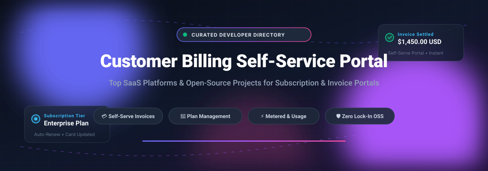

# 💳 Awesome Customer Billing Self-Service Portal 

  
  
  
  
  

  

> 🌟 **A curated directory of top SaaS platforms and open-source GitHub projects for Customer Billing Self-Service Portals, Subscription Management, and Client Payment Dashboards.**

Customer Billing Self-Service Portals empower subscribers to manage credit cards, view and settle invoices, adjust pricing tiers, check metered usage, and handle recurring renewals—without burdening support teams or finance operations.

---

## 📑 Table of Contents

- [🌐 Sector Overview & Market Dynamics](#-sector-overview--market-dynamics)
- [🏢 SaaS & Hosted Platforms](#-saas--hosted-platforms)
- [💻 Open-Source GitHub Projects](#-open-source-github-projects)
- [🎯 Architecture & Feature Matrix](#-architecture--feature-matrix)
- [🤝 How to Contribute](#-how-to-contribute)
- [💖 Support](#-support)
- [📈 Star History](#-star-history)
- [⚖️ Disclaimer](#️-disclaimer)

---

## 🌐 Sector Overview & Market Dynamics

The global subscription and billing management software market is valued at **$7.5B – $9.2B** in 2025 and is projected to expand to **$8.6B – $11.0B** in 2026 (compounding at over 14% CAGR). Market acceleration is primarily fueled by rapid business transitions from static subscriptions to complex hybrid/metered usage-based pricing models, cross-border e-invoicing compliance, and automated dunning/churn mitigation.

From a market dynamics perspective, the sector exhibits **moderate concentration at the enterprise tier**—dominated by multi-product infrastructure ecosystems like Stripe, Oracle, and SAP that bundle billing with payment rails and enterprise ERPs. Conversely, the market remains **highly fragmented across the mid-market and SME segments**, where specialized pure-play subscription engines (Chargebee, Recurly, Maxio, Rebilly) and modular open-source alternatives vigorously compete, preventing any single winner-take-all monopoly.

---

## 🏢 SaaS & Hosted Platforms

*Commercial self-service billing portals offering turnkey client dashboards, automated payment gateway orchestration, and enterprise compliance. Ranked in descending order of company scale.*

| Product | Scale (Valuation / Revenue) | Star / Portal Focus | Pricing (Starting Tier) | Free Tier / Trial Limits |
|:---|:---|:---|:---|:---|
| **[Stripe Customer Portal](https://stripe.com/)** | **~$159B Valuation** (~$6.8B Revenue) | Hosted self-service portal for updating payment methods, downloading invoices, and switching subscriptions. | 0.70% of billing volume for recurring subscriptions (or 0.40% per paid invoice on Invoicing Starter) | No standalone free tier for live charges; provides unlimited free Developer Test Mode / sandbox simulation with test cards |
| **[Chargebee Customer Portal](https://www.chargebee.com/)** | **~$3.5B Valuation** (~$115M+ ARR) | Dedicated customer self-service billing portal within Chargebee's subscription and revenue lifecycle platform. | Starter plan: $0/month for first $250k cumulative revenue, then $599/month (or Flow PAYG starting at 0.80% of invoicing volume) | **14-day free trial** with full platform capabilities; plus **Chargebee for Startups** free tier up to $1M cumulative billing |
| **[Recurly Subscriber Portal](https://recurly.com/)** | **Private / PE-backed** (~$50M–$60M ARR) | Hosted subscriber self-service portal with passwordless login for payment and subscription management. | Starter tier: $249/month + 0.90% of billing volume (includes first $40,000/month volume at no extra rate) | **14-day free trial** with full sandbox environment access for testing subscriber workflows |
| **[Maxio Customer Portal](https://www.maxio.com/)** | **Private / PE-backed** (~$50M+ ARR) | Customer portal for self-service subscription and contract changes, bundled with B2B SaaS metrics & ASC 606 RevRec. | Grow tier starts at $599/month (includes self-service customer portal with unlimited users) | **30-day free trial** on Build developer sandbox tier with API, product catalog, and portal testing |
| **[Rebilly Customer Portal](https://www.rebilly.com/)** | **Bootstrapped / Private** (~$6M–$10M ARR) | Payment orchestration and recurring billing platform offering complete hosted customer self-service. | Basic tier: $15/month + 1% transaction fee (Pro tier starts at $125/month + 1%) | **30-day free trial** with full platform access, unlimited team members, and no credit card required |

---

## 💻 Open-Source GitHub Projects

*Self-hosted billing platforms, open-source invoicing systems, and usage-based metering engines featuring customer-facing self-service portals. Sorted in descending order by GitHub stargazers count.*

| Project | Stars_Badge | Description | Tech Stack |
|:---|:---|:---|:---|
| **[Lago](https://github.com/getlago/lago)** |  | Open-source metered billing and usage-based pricing platform with an extensible **customer portal** featuring real-time consumption analytics, invoice history, and self-serve prepaid wallet top-ups. | Go / Ruby / TypeScript |
| **[Invoice Ninja](https://github.com/invoiceninja/invoiceninja)** |  | Battle-tested open-source invoicing, payments, and client management suite with a **branded client portal** featuring passwordless/SSO login, quote acceptance, online invoice payments, and subscription tracking. | PHP (Laravel) / Flutter |
| **[Crater](https://github.com/crater-invoice/crater)** |  | Open-source invoicing solution designed for freelancers and small enterprises with a clean **client-facing payment portal**, estimate approvals, expense tracking, and mobile apps. | PHP (Laravel) / Vue.js |
| **[Kill Bill](https://github.com/killbill/killbill)** |  | Enterprise-grade open-source subscription billing and payments platform with modular self-service interfaces, complex catalog management, dunning workflows, and gateway integrations. | Java / OSGi |
| **[OpenMeter](https://github.com/openmeterio/openmeter)** |  | Cloud-native open-source usage metering and monetization engine designed for AI and API products, providing client-facing consumption widgets and real-time balance portals. | Go / C++ / TypeScript |
| **[InvoiceShelf](https://github.com/InvoiceShelf/InvoiceShelf)** |  | Open-source web-based invoicing and client management software with an integrated **client portal** where customers can review invoices, download PDFs, and process card payments. | PHP (Laravel) / Vue.js |
| **[FOSSBilling](https://github.com/FOSSBilling/FOSSBilling)** |  | The premier open-source client billing portal for web hosting and digital service providers. Includes a **turnkey customer self-service area** for service provisioning, support ticketing, recurring invoice settlement, and payment gateway routing. | PHP / Twig / MySQL |
| **[ITFlow](https://github.com/itflow-org/itflow)** |  | Open-source IT documentation and PSA platform for MSPs featuring a dedicated **client self-service portal** for reviewing billing invoices, quotes, payment history, and ticket submissions. | PHP / Bootstrap / MySQL |
| **[PNLCS](https://github.com/Panelica/pnlcs)** |  | Modern open-source alternative to WHMCS built on Laravel with an **end-to-end client billing portal** managing hosting services, DNS, email accounts, recurring invoicing, and payment processing. | PHP (Laravel) / Vue.js |

---

## 🎯 Architecture & Feature Matrix

When evaluating whether to adopt a commercial SaaS billing portal or self-host an open-source solution, consider the following architectural factors:

* **Data Sovereignty & Compliance:** Open-source platforms like **Lago**, **Kill Bill**, and **Invoice Ninja** allow you to keep subscriber records, payment logs, and catalog data on private infrastructure, meeting stringent GDPR, HIPAA, and localized data-residency mandates.
* **Margin Protection:** SaaS billing engines routinely levy a volume fee (ranging from **0.40% to 1.00%+** of Gross Merchandise Volume). For high-margin or large-volume organizations, running self-hosted software eliminates transaction rent.
* **Hosted Security & PCI Scope:** Commercial hosted portals (such as **Stripe Customer Portal** or **Chargebee**) assume SAQ-A PCI compliance, managing tokenized card inputs on certified infrastructure and shielding internal systems from cardholder data exposure.
* **Turnkey vs. Composable Portals:** Systems like **FOSSBilling** provide out-of-the-box client areas with minimal coding required, while engines like **OpenMeter** provide API building blocks to embed usage dashboards into custom frontend applications.

---

## 🤝 How to Contribute

Contributions are warmly welcomed! Help keep this curated ecosystem up-to-date:

1. 🍴 **Fork the repository** on GitHub.
2. 🌿 **Create a new branch** (`git checkout -b feature/add-billing-portal`).
3. ✍️ **Add or refine an entry** in `README.md` adhering to the existing tabular format, including factual pricing tiers, trial limits, or Stars_Badges.
4. 🚀 **Submit a Pull Request** with a brief summary explaining the additions.

---

## 💖 Support

If you find this curated collection useful for your projects or architecture research, please consider supporting the project:

- ⭐ **Star this repository** to help other developers and finance engineers discover it.
- 🍴 **Fork and share** with teammates, communities, and colleagues.
- ☕ **Buy me a coffee / Sponsor:** Support ongoing maintenance and open-source research via the [GitHub Sponsor Dashboard](https://github.com/sponsors/ishandutta2007).

---

## 📈 Star History

---

## ⚖️ Disclaimer

- This repository is a **community-curated list** provided for educational and architectural reference only—it is neither an endorsement nor financial advisory.
- Customer billing portals manage financial data and payment credentials. Always enforce PCI DSS compliance (tokenized gateway sessions), multi-factor authentication, and thorough audit trails for customer actions.
- Portal feature sets differ across plan tiers. Ensure verified compatibility with your company's billing requirements before production deployment.

---

  Maintained with ❤️ by <a href="https://github.com/ishandutta2007">Ishan Dutta</a> and community contributors.

